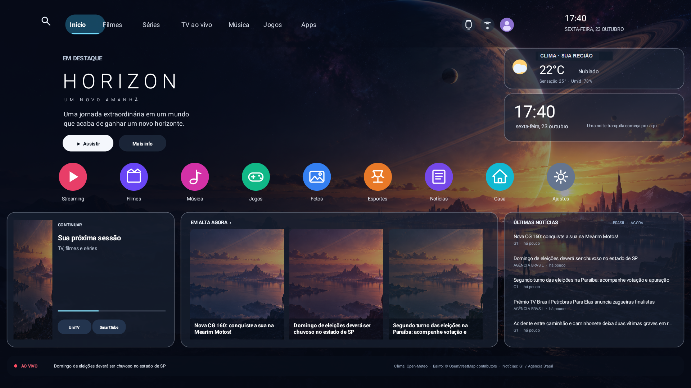
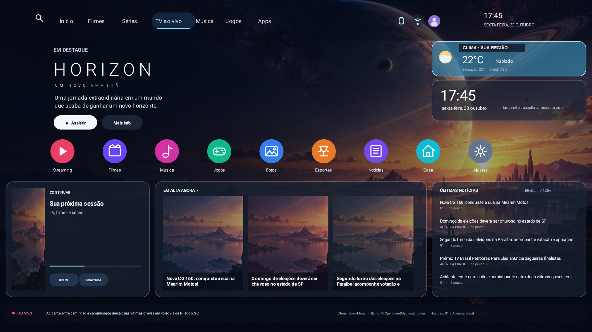

# Horizon TV

Launcher independente para Android TV, inspirado no painel Horizon: fundo sci-fi, navegação superior, dock central com ícones circulares, clima local com bairro, manchetes brasileiras e relógio.

## Capturas da interface

As imagens abaixo foram capturadas em uma TCL com Android TV 12, em 1920×1080. O bairro da localização real foi ocultado nas cópias públicas.

**Tela inicial**



**Cartão de clima selecionado pelo controle remoto**



Os cartões e a dock são dimensionados pela largura e altura da tela; a faixa inferior ocupa 98% da largura disponível.

## Dados e privacidade

- O app solicita somente localização aproximada (`ACCESS_COARSE_LOCATION`) e só a consulta enquanto a tela inicial está aberta. Não há rastreamento em segundo plano.
- A dock mostra localmente os apps que oferecem uma atividade de inicialização na TV. A lista de apps não é enviada a serviços externos.
- O card Continuar guarda localmente o nome e o pacote do último app aberto pelo Horizon e o abre novamente ao selecionar o card. O launcher não lê o histórico global de uso nem envia esse registro.
- Os três cards Em alta mostram imagens e manchetes diferentes. O painel Últimas notícias continua com mais cinco histórias, começando depois dos destaques para não repetir os mesmos cards. Manchetes repetidas entre fontes são filtradas por URL e título normalizado. A TV baixa as três imagens exibidas por HTTPS dos servidores de mídia do G1 e da Agência Brasil; as URLs ficam no cache privado junto com as manchetes.
- O fundo pode alternar diariamente entre fotografias do Openverse. No item **Personalizar** da barra superior, escolha temas, informe uma busca própria, atualize a imagem ou volte ao fundo original. A busca anônima filtra imagens horizontais sem conteúdo maduro com licença CC0, CC BY ou CC BY-SA; imagens são baixadas por HTTPS somente de `live.staticflickr.com`. A imagem fica no armazenamento privado da TV, e título, autor e licença aparecem na tela. O menu fornece os créditos completos e links da origem e licença. Se a rede falhar, mantém o último fundo salvo ou a arte local. A atualização automática ocorre no máximo uma vez por dia.
- As coordenadas são arredondadas para duas casas decimais e guardadas nas preferências locais para reutilizar a previsão. São enviadas por HTTPS à Open-Meteo para o clima e ao OpenStreetMap Foundation (Nominatim) para identificar o bairro aproximado.
- A consulta Nominatim é feita uma vez na configuração inicial e repetida somente após deslocamento aproximado de 2,5 km e no máximo uma vez por dia; o nome retornado fica em cache local. Se o mapa não tiver um bairro, a tela usa a cidade. O ponto mais próximo do mapa pode não corresponder exatamente à coordenada informada.
- Na primeira consulta, uma confirmação explica o envio ao OpenStreetMap; a pessoa pode recusar e continuar usando o clima sem o nome do bairro. Para apagar o bairro salvo, limpe os dados do Horizon em Configurações do Android TV.
- O clima usa condições atuais da Open-Meteo, com atualização a cada 30 minutos. A tela mostra a fonte. Consulte [documentação](https://open-meteo.com/en/docs) e [termos](https://open-meteo.com/en/terms); o serviço gratuito é destinado a usos não comerciais e requer atribuição.
- As imagens vêm da [API Openverse](https://api.openverse.org/v1/), que permite consultas anônimas sujeitas a limites de frequência. Consulte a [documentação oficial](https://docs.openverse.org/). O app não incorpora chave de API.
- A API Pexels foi avaliada para esse recurso e não foi usada: suas [diretrizes oficiais](https://www.pexels.com/api/documentation/) proíbem disponibilizar conteúdo como um app de papéis de parede e exigem uma chave em cada requisição.
- O cartão que antes repetia o relógio agora mostra um versículo aleatório diário em português, na tradução João Ferreira de Almeida, fornecido pela [bible-api.com](https://bible-api.com/). O texto e a referência ficam no cache privado da TV; a consulta ocorre uma vez ao dia e também pode ser solicitada ao selecionar o cartão. O serviço informa que a tradução está em domínio público, limita o uso a 15 requisições por IP a cada 30 segundos e não garante disponibilidade; sem rede, o último versículo continua visível.
- O destaque mostra um filme popular obtido sem cadastro no catálogo público Cinemeta do Stremio. Título, sinopse e ano ficam em cache local por 24 horas; a imagem é baixada ao abrir a tela inicial, somente de `images.metahub.space`, com limites de tamanho e dimensões. **Ver no TMDB** abre a ficha do TMDb quando o catálogo fornece seu identificador, e **Outra sugestão** busca outro título. A consulta não usa a API oficial do TMDb, que exige chave; o Cinemeta não publica garantia de estabilidade e pode mudar ou ficar indisponível. Referências: [catálogo oficial de complementos Stremio](https://github.com/Stremio/stremio-official-addons/blob/master/index.json) e [endpoint de filmes populares](https://cinemeta-catalogs.strem.io/top/catalog/movie/top.json).
- O nome do bairro vem de uma consulta reversa Nominatim, com agente `HorizonTV/1.0`, atribuição `© OpenStreetMap contributors` na tela e cache para evitar consultas periódicas. Aplicam-se a [documentação da API](https://nominatim.org/release-docs/latest/api/Reverse/) e a [política de uso](https://operations.osmfoundation.org/policies/nominatim/).
- Notícias são manchetes gerais do Brasil, obtidas por RSS do [G1](https://g1.globo.com/rss/g1/) e da [Agência Brasil](https://agenciabrasil.ebc.com.br/rss/ultimasnoticias/feed.xml). A tela atualiza a cada 15 minutos, identifica a fonte e abre os artigos apenas por HTTPS nos domínios dessas fontes.
- A sugestão de filme consulta apenas um catálogo público, sem enviar identificadores da TV ou dados de conta. URLs de metadados são fixas; imagens e links de detalhes são validados por HTTPS, domínio e caminho, redirecionamentos são desativados e as respostas têm limites de tamanho. Verificação de segurança: [MITRE CWE-918, versão 4.20](https://cwe.mitre.org/data/definitions/918), [OWASP ASVS 5.0.0](https://owasp.org/www-project-application-security-verification-standard/); sem dependências novas, portanto não houve consulta OSV de pacotes adicionados.
- Conteúdo RSS é externo e tratado como dado: o parser limita a resposta a 512 KiB, bloqueia DTD/entidades externas, e os links são validados por protocolo e host. As preferências que incluem coordenadas ficam excluídas do backup e da transferência do Android.
- Na primeira abertura após esta atualização, configurações e chaves locais da funcionalidade descontinuada são removidas.
- Permissões declaradas: internet e localização aproximada. Tráfego HTTP sem TLS é desativado. O app não pede microfone, armazenamento ou localização precisa.

## Compilar e verificar

Requisitos locais: JDK 21 e Android SDK com plataforma 34 e Build Tools instaladas. O alvo mínimo é Android 8 (API 26); a TV informada roda Android 12 (API 31).

```powershell
.\gradlew.bat --no-daemon testReleaseUnitTest lintRelease assembleRelease
```

O APK é `app/build/outputs/apk/release/app-release.apk`. Os testes unitários cobrem parsing RSS, remoção de marcação, rejeição de URLs inseguros, bloqueio de entidades XML, descrição meteorológica e navegação da barra superior. O lint e o build release fazem parte do mesmo gate.

## Instalação e retorno

Com depuração de rede ativada na TV e ADB pareado, instale e abra sem alterar o launcher padrão:

```powershell
$env:TV_HOST = '<ip-da-tv>:5555'
.\scripts\install.ps1
```

Após conferir a tela, é possível definir Horizon como tela inicial com `-SetAsHome`. O launcher anterior `com.gathin.tvhome` permanece instalado. Para voltar:

```powershell
$env:TV_HOST = '<ip-da-tv>:5555'
.\scripts\restore-home.ps1
```

O smoke em TV inicia a tela inicial pelo fluxo HOME, aguarda a atualização de dados e salva uma captura em `artifacts/`:

```powershell
$env:TV_HOST = '<ip-da-tv>:5555'
.\scripts\smoke-tv.ps1
```

O smoke da navegação da tela inicial abre o Horizon pela TV e percorre os oito itens da barra superior até retornar ao início:

```powershell
$env:TV_HOST = '<ip-da-tv>:5555'
.\scripts\smoke-home-navigation-tv.ps1
```

Para conferir os cards com as imagens das manchetes, use o smoke dedicado. Ele compila, instala, abre Horizon pela tela inicial, aguarda a consulta de notícias e salva uma captura local para inspeção visual:

```powershell
$env:TV_HOST = '<ip-da-tv>:5555'
.\scripts\smoke-news-images-tv.ps1
```

Para validar o cartão de versículo pela navegação do controle remoto, rode o cenário dedicado. Ele abre o Horizon pelo botão HOME, navega até o cartão, confirma o foco acessível e salva uma captura para conferir o texto, a referência e o relógio da barra:

```powershell
$env:TV_HOST = '<ip-da-tv>:5555'
.\scripts\smoke-bible-verse-tv.ps1
```

Para validar o fundo dinâmico, rode o smoke dedicado. Ele compila, instala, abre Horizon pela atividade de TV, navega com o controle até **Personalizar**, escolhe um tema, aguarda a imagem e verifica os créditos:

```powershell
$env:TV_HOST = '<ip-da-tv>:5555'
.\scripts\smoke-background-tv.ps1
```

O usuário pode conceder ou negar localização na própria tela. Se a TV não tiver um provedor de localização de rede habilitado, o painel continua funcionando e mostra o estado do clima; nenhuma localização é inferida a partir do IP. Para abrir artigos é necessário ter um navegador instalado.

## Análise de segurança (2026-10-23)

- **Referência local do card Continuar** — nome e pacote são valores simples em preferências privadas do app; não há permissão de histórico de uso nem transmissão. Verificação: inspeção do armazenamento `MODE_PRIVATE`, manifesto e fluxo de abertura. Referência oficial consultada em 2026-10-23: [armazenamento de dados e preferências no Android](https://developer.android.com/training/data-storage).
- **Visibilidade de apps instalados** — a dock consulta atividades de inicialização por meio de assinaturas declaradas em `<queries>` no manifesto; não usa `QUERY_ALL_PACKAGES` e não transmite a lista. Revisão estática de `AndroidManifest.xml` e do fluxo `queryIntentActivities`; build e lint concluídos. Referência oficial consultada em 2026-10-23: [Package visibility on Android](https://developer.android.com/training/package-visibility).
- **XML externo / CWE-611** — feeds RSS são entrada não confiável; DTD, entidades externas e resolução de DTD são desativadas. Verificação: `NewsFeedReaderTest.rejectsExternalEntityDeclarations`; resultado esperado: parser rejeita o documento. Referência oficial: https://cwe.mitre.org/data/definitions/611 .
- **URLs e dados de imagem dos feeds / CWE-918 — severidade baixa** — URLs RSS não confiáveis poderiam direcionar o cliente a destinos indevidos ou fornecer dados grandes/malformados. Só são aceitos HTTPS e hosts de mídia `*.glbimg.com`, `imagens.ebc.com.br` e `agenciabrasil.ebc.com.br`; redirecionamentos são recusados; downloads têm timeout, limite de 2 MiB, validação de MIME e dimensão/pixels antes da decodificação amostrada. Verificação: testes de parsing dos dois feeds e de rejeição de hosts e protocolos indevidos; smoke visual na TCL. Limitação: os hosts/CDNs permitidos continuam sendo dependências confiáveis. Referências oficiais consultadas em 2026-10-23: [MITRE CWE-918, versão 4.20](https://cwe.mitre.org/data/definitions/918) e [Android BitmapFactory](https://developer.android.com/reference/android/graphics/BitmapFactory).
- **Comunicação / ASVS 5.0.0** — apenas HTTPS, hosts de notícia permitidos e sem tráfego cleartext; feed limitado por tamanho e timeouts. Verificação: testes de URL HTTPS/host e configuração do Manifest. Referência: https://asvs.owasp.org/ (versão 5.0.0, estável em 2025-05-30).
- **Localização e menor privilégio** — apenas localização aproximada em primeiro plano; coordenadas arredondadas e sem backup. O cache evita consultas repetidas ao Nominatim. Verificação: inspeção de `AndroidManifest.xml`, fluxo de permissão e regras de extração. Referências: https://developer.android.com/develop/sensors-and-location/location/permissions e https://operations.osmfoundation.org/policies/nominatim/ .
- **Exposição de localização — severidade média, consentida** — o Nominatim recebe coordenadas aproximadas para nomear o bairro; aviso de consentimento, arredondamento, cache local e consulta limitada reduzem exposição. Resultado consultado via HTTPS; validação manual do ponto de exemplo confirmou resposta de bairro. Fontes oficiais consultadas em 2026-10-23: https://nominatim.org/release-docs/latest/api/Reverse/ e https://operations.osmfoundation.org/policies/nominatim/ .
- **Resposta da API bíblica / CWE-1287 — severidade baixa** — conteúdo externo malformado poderia mostrar referência incorreta ou exceder o consumo esperado. O parser exige os campos JSON esperados, texto e coordenadas válidos, recusa redirecionamentos, limita o corpo a 32 KiB e os textos a 4.000 caracteres antes do cache privado. Verificação: `BibleVerseClientTest` cobre parsing, campos ausentes, texto vazio e coordenadas inválidas; o smoke na TCL conferiu a navegação e a exibição de conteúdo real. Nenhum dado pessoal é enviado. Limitação: disponibilidade e conteúdo dependem do serviço comunitário bible-api.com. Referências consultadas em 2026-10-23: [documentação e termos da API](https://bible-api.com/) e [MITRE CWE-1287, versão 4.20](https://cwe.mitre.org/data/definitions/1287).
- **Imagens Openverse / CWE-918 — severidade baixa** — URLs externas e respostas grandes poderiam direcionar o cliente a um host imprevisto ou consumir memória excessiva. A busca usa host e caminho fixos; fotos só são aceitas quando o provedor é Flickr e o host de mídia é exatamente `live.staticflickr.com`, sem redirecionamentos. JSON e imagem têm limites de tamanho, MIME e dimensões; só são aceitas imagens não maduras CC0, CC BY e CC BY-SA. Título, autor, origem e licença ficam disponíveis na tela/menu. Verificação: `OpenverseImageClientTest` cobre licenças, conteúdo maduro, domínio de mídia e URLs de origem/licença inválidas; o smoke dedicado percorre o menu na TCL. Limitação: o catálogo fornece metadados de licença/conteúdo que não foram auditados individualmente. Referências oficiais consultadas em 2026-10-23: [documentação Openverse](https://docs.openverse.org/), [MITRE CWE-918, versão 4.20](https://cwe.mitre.org/data/definitions/918.html) e [OWASP ASVS 5.0.0, V13.2.5](https://cornucopia.owasp.org/taxonomy/asvs-5.0/13-configuration/02-backend-communication-configuration).
- **Dependências** — não há dependências externas de runtime. Consulta à API OSV em 2026-10-23 retornou 0 avisos para JUnit 4.13.2 e `org.json:json` 20260814, usados somente em testes; plugins Gradle/Android SDK são dependências de build, não incluídas no APK.
- **Risco residual** — disponibilidade e conteúdo dos feeds/API dependem dos provedores e da rede da TV. A fonte dos dados, não o app, define a exatidão meteorológica. Não foi feita auditoria independente dos provedores nem varredura de rede externa.

## Recursos do projeto

Implementação Java nativa, sem dependências de runtime de terceiros. JUnit e `org.json` são usados só nos testes locais. O projeto mantém o launcher `cleanyourtv` intacto e conserva o wallpaper sci-fi aprovado como fundo alternativo.
